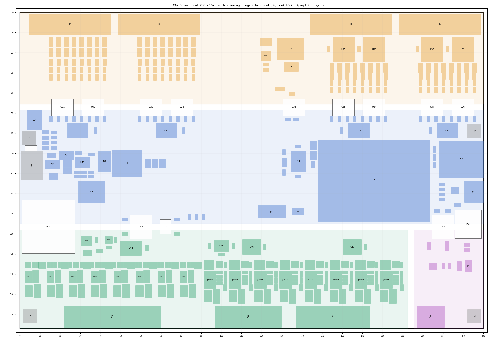

# C02IO: Raspberry Pi CM5 industrial I/O board (design spec)

**Rev B (2026-11-23): the controller is now a Raspberry Pi Compute Module 5.** Rev A's W65C02S system (CPU, RAM, flash, VIA, UART, address decoding, clock, reset, USB-serial and bus expansion headers) is gone. All the I/O is unchanged except where it meets the logic side, which now runs at 3.3 V. The CM5 adds gigabit Ethernet and a USB-C port for flashing.

Status:
- **Netlist:** `python check_board.py` passes. Every new part was checked against its datasheet (listed at the top of `board.py`).
- **Placement:** `python check_place.py png` passes (no courtyard overlaps, every part inside its isolated area, bridge pads on the right side of each gap). The board grew 10 mm to 230 x 157 mm to fit the 55 x 40 mm module.
- **Schematic:** `python check_sch.py` passes. ERC shows 0 errors and 0 warnings, and KiCad's netlist matches `board.py` (365 nets, 494 parts).
- **PCB:** `mk_pcb.py` builds it. DRC shows 0 errors, with 499 connections still to route.
- **Next:** route it (`python mk_fab.py --route`, see Routing). Lay out the Ethernet and USB pairs carefully first (see Still to do).



This is a small PLC-style controller:
- 16 opto-isolated 24 V digital inputs
- 16 opto-isolated 24 V sourcing outputs, 0.5 A each
- 8 analog inputs and 8 analog outputs, each set to 0-10 V or 4-20 mA with a jumper, isolated as a group
- isolated RS-485 (Modbus RTU)
- gigabit Ethernet, and USB-C for flashing the CM5's eMMC (rpiboot) or a gadget console

## Choices made

| | Choice | Why |
|---|---|---|
| Controller (rev B) | **Raspberry Pi CM5**, on two Amphenol 10164227-1001A1RLF connectors (1.5 mm stack) | Linux, Ethernet, plenty of speed. The footprint is Raspberry Pi's own, from the CM5 IO board's KiCad files (`vendor/cm5io`). Any CM5 variant fits; a Lite one has nowhere to boot from here, so use an eMMC module. |
| Interfaces (rev B) | **Ethernet RJ45, USB-C** | USB-C is a USB 2.0 device port for rpiboot and console. There is no USB host port, HDMI, SD slot or RTC battery. |
| Build | **SMD, assembled by JLCPCB** | You solder the through-hole parts: terminals, headers, the MagJack and the URB converter. |
| Analog | **0-10 V or 4-20 mA, one jumper per channel** | Analog inputs use a 2-pin jumper, analog outputs a 2x3 header with two shunts. |
| Outputs | **Sourcing (high-side), 0.5 A, short-circuit protected** | The standard for PLCs driving relays, valves and lamps. |
| Analog isolation | **Yes, as one group** | The analog section has its own isolated 24 V supply and ground, and talks to the CM5 through digital isolators. The channels share that ground with each other. |
| Layers | **4** | Ground planes under everything, which helps the analog section and the Ethernet pairs. |

## Block diagram

```
 FOUR ISOLATED AREAS: logic (GND), field digital (0V_IO), analog (AGND_ISO), RS-485 (GND_485)

 24V IN --fuse--diode--TVS--+-- TPS54560B buck --> +5V --> CM5 (its 3.3 V output = logic +3V3)
                            +-- URB2424YMD-6WR3 isolated DC-DC --> +24VA, AGND_ISO
                                    +24VA --> 78L05 --> +5VA --> REF3040 (4.096 V)

 CM5 --+-- Ethernet --> MagJack;  USB 2.0 --> USB-C (device)
       |                                                      || FIELD DIGITAL (0V_IO)
       +-- SPI0 <-- 74HC165 x2 <-- pull-ups <-- TLP291-4 x4 <--||---- 16 inputs (LED + opto per input)
       +-- SPI0 --> 74HC595 x2 --> R --> LED of TLP291-4 x4 ---||---> VNI4140K x4 --> 16 outputs, LED each
       |              ^ /OE = watchdog /Q (GPIO5 enable, GPIO4 kick) || STATUS (wire-OR) --> opto --> GPIO22
       |                                                      ||  24V_IO IN --> VNI4140K, 78L05 (+5V_IO); --PTC-->
       |                                                      ||                       sensor supply terminals
       +-- UART0 (RTS = DE) --> CA-IS3082WX -------------------||---- RS-485 A/B (GND_485, from B0505XT)
       +-- SPI1 --> ISO7741 + ISO7720 -------------------------|| ANALOG (AGND_ISO)
                                                              ||-- MCP3208 ADC <-- 8 x (divider, 499R mA jumper, PTC, TVS)
                                                              ||-- DAC7568A --> 8 x (LM324 + NPN, V/I jumper) --> AO
```

Each area has its own ground. Only optocouplers, digital isolators, the isolated DC-DC converters and the isolated RS-485 chip cross between them. The 8 analog channels are isolated from the logic, the field I/O and the power input, but not from each other: they share AGND_ISO.

## CM5 GPIO use

| GPIO | Use |
|---|---|
| 11, 10, 9 | SPI0 SCLK, MOSI, MISO: the shift registers |
| 8 | SPI0 CE0: 74HC595 latch (RCLK). It rises at the end of the transfer, so all 16 outputs change at once. |
| 6 | 74HC165 load (`/PL`): pulse low, then clock the inputs in |
| 21, 20, 19 | SPI1 SCLK, MOSI, MISO, to the analog side through the ISO7741 |
| 18, 16 | SPI1 CE0 = ADC `/CS`, CE2 = DAC `/SYNC` (10k pull-ups) |
| 24 | DAC `/LDAC`: updates all 8 outputs at once |
| 14, 15 | UART0 TX, RX: RS-485 |
| 17 | UART0 RTS: RS-485 driver enable. Use Linux's RS-485 mode, set so the pin is high while sending. A 10k pull-down keeps the driver off during boot, when the bootloader logs on GPIO14/15. |
| 5 | Output enable, pulled low. **The outputs stay off until software sets this.** |
| 4 | Watchdog kick (74HC123: if not toggled for ~100 ms, the outputs drop) |
| 12, 13 | RUN and FAULT LEDs |
| 22 | Output fault in (any VNI4140K over-temperature), through an opto; low = fault |
| 23 | Field power present (24V_IO), through an opto; low = present |
| 2, 3, 7, 25, 26, 27 | Expansion header J11 (2x5): 3V3, 5V, SDA (2), GND, SCL (3), 25, 26, 27, GND, 7. GPIO2/3 have 1.8k pull-ups on the module. |

**One SPI0 transfer does all the digital I/O.** Pulse GPIO6 low, then do one 16-bit transfer on CE0:
- **Out:** the bytes for outputs 16..9 then 8..1, MSB first.
- **In:** the bytes for inputs 8..1 then 16..9, MSB first, low = on. Software inverts them.

CE0 rising at the end of the transfer latches the outputs. Don't use CE0 for a read-only transfer, because it would latch whatever MOSI shifted in.

**Other CM5 pins:**
- **Power and ground:** all 51 ground pins go to GND. 5 V goes to the six VIN pins. GPIO_VREF is tied to the module's own 3.3 V output, which also powers the whole logic side (600 mA max; about 150 mA used).
- **Front-panel controls:** `nRPIBOOT` goes to jumper JP1; fit it before power-up to flash the eMMC over USB-C. `PWR_Button` goes to SW1. The activity LED (`LED_nACT`) is D8.
- **Left open:** PMIC_Enable, EEPROM_nWP, the Wi-Fi/Bluetooth disables, USB_OTG_ID (so it is a device), CC1/CC2, VBAT, fan, SD, PCIe, MIPI, HDMI and USB 3.
- **Power warning:** the CM5 warns about its supply unless it negotiated 5 A over USB-C. Set `PSU_MAX_CURRENT=5000` in its bootloader EEPROM.

## Circuits

**Digital input (x16), IEC 61131-2 type 1/3 style:**
- **Signal path:** terminal → 4.7k (1206) → green LED → opto LED, with 2.2k and 10 nF across the opto LED, then → 0V_IO. An antiparallel 1N4148W protects against reverse voltage.
- **Thresholds:** about 1.7 mA at 11 V reads ON. 5 V stays OFF, because the shunt keeps the opto LED below its threshold. 30 V draws 5.7 mA.
- **Logic side:** the opto transistor pulls the input low against a 22k pull-up to 3.3 V, and a 74HC165 reads it. Software inverts the reading, so 1 = ON.
- **Wiring:** sourcing (PNP) sensors connect between 24V_IO and the input. 0V_IO is the common.

**Digital output (x16):**
- **Signal path:** 74HC595 → 330 Ω → opto LED (about 5 mA from 3.3 V). The opto transistor drives the VNI4140K input from +5V_IO, with a 10k pull-down.
- **Driver:** the VNI4140K is a quad high-side switch: 3.3 V CMOS inputs, 0.6 A per channel in the current datasheet (0.7 A in older ones), current limiting and per-channel thermal shutdown.
- **Indication:** a yellow LED and 4.7k from each output to 0V_IO light when the output is on.
- **Faults:** each VNI4140K has one open-drain STAT pin per channel. All 16 are wire-ORed through one opto to GPIO22. STAT goes low **only on over-temperature** (with IN high), not while the output is current-limiting a short.
- **Supply:** the VNI4140K's exposed slug is **Vcc** (24V_IO), not ground. 24V_IO feeds the four drivers directly (up to 8 A with all outputs on), so **fuse the field supply outside the board**. A reversed field supply is shorted by the SMBJ33A, which must blow that fuse.
- **Start-up and crashes:** the 74HC595s' `/OE` comes from the 74HC123's `/Q`:
  - It stays high (outputs off) until software has written the latches, set GPIO5 and started kicking GPIO4.
  - It goes high again if the kicks stop for about 100 ms. That is about 106 ms at 3.3 V; kick it at least every 25 ms.

**Analog isolation:**
- **Power:** a Mornsun URB2424YMD-6WR3 (9-36 V in, isolated 24 V out, 6 W) makes +24VA on AGND_ISO. A 78L05 makes +5VA for the ADC, DAC and isolators' analog side, and a REF3040 makes the 4.096 V ADC reference.
- **Budget:** 8 outputs at 20 mA from 24 V is about 4 W, plus about 0.5 W for the rest, so the 6 W converter runs at about 75 %.
- **SPI:** an ISO7741 (3 channels to the analog side, 1 back) carries SCLK, MOSI, ADC `/CS` and MISO. An ISO7720 (2 channels) carries DAC `/SYNC` and `/LDAC`. Use the default-high versions, so the chip selects sit inactive while the logic side is unpowered. Side 1 runs at 3.3 V and side 2 at 5 V; the supplies can be set independently. Keep SPI1 at a few MHz: the isolators add about 10 ns each way.

**Analog input (x8):**
- **Signal path:** terminal → PTC (50 mA hold) → SMAJ12A TVS to AGND_ISO → 15k/10k divider (10 V → 4.0 V) → 1k → ADC, with 100 nF and BAV99 clamps to +5VA/AGND_ISO.
- **4-20 mA:** a jumper puts **499 Ω (2010, 0.5 W)** across the input, so 20 mA reads about 9.8 V. Software calibrates it, and a table in software says which channels are mA.
- **ADC:** MCP3208, 12-bit, with a 4.096 V reference (REF3040), so the input range is 0-10.24 V.
- **Mistakes:** 24 V on an input trips the PTC into the TVS.

**Analog output (x8):**
- **DAC:** DAC7568**A**, 12-bit, 8 channels, internal 2.5 V reference, gain 1, so 0-2.5 V. The internal reference is **off at power-up and after a reset**: firmware must enable it. Its outputs drive an LM324 (2 chips, on +24VA), and the op-amp drives an NPN emitter follower (BCX56, SOT-89) from +24VA.
- **Current limit:** a 22 Ω resistor with a sensing transistor limits the output to about 26-29 mA.
- **2x3 jumper:** both shunts left = **0-10 V**: feedback from a 30k/10k divider on the terminal side of the PTC (gain 4), and COM tied to AGND_ISO. Both shunts right = **4-20 mA**: feedback from COM, which returns through a 124 Ω (0.1 %) sense resistor, so 2.5 V gives 20.2 mA.
- **Compensation:** 10k in series with the op-amp's inverting input and 10 nF from its output to that input, plus 10 nF on OUT. These are starting values to check in simulation.
- **Compliance:** about 900 Ω at 20 mA, from the isolated 24 V (only 2.5 V is lost in the sense resistor).
- **Protection:** a PTC and an SMAJ15A TVS at each terminal.
- **Wiring:** in mA mode the load goes between OUT and COM. In V mode, COM is 0 V (AGND_ISO).

**Power:**
- **Input:** 24 V nominal (18-32 V) → 3 A fuse → SS54 reverse diode → SMBJ33A TVS.
- **5 V regulator:** a TPS54560B (4.5-60 V in, 5 A, HSOIC-8) makes +5 V for the CM5 and the RS-485 converter. The values come from TI's 5 V / 5 A design: 400 kHz, B560C catch diode, 10 µH (Bourns SRP1245A), 3 x 47 µF. The CM5 datasheet asks for up to 2.5 A for the module.
- **3.3 V:** from the CM5's own output, so nothing drives a CM5 pin while the module is off.
- **Analog supply:** its own isolated converter (see Analog isolation).
- **Field supply:** 24V_IO is a separate pair of terminals. It can come from the same supply, but isolation only helps if it doesn't.

**RS-485:**
- **Chips:** CA-IS3082WX (isolated transceiver, SOIC-16 wide; logic side 3.3 V, bus side 5 V), powered on the bus side by a B0505XT-1WR3 (SMD) isolated DC-DC converter. The converter needs a 20 mA minimum load, so a 330 Ω resistor (15 mA) sits across its output.
- **Bus side:** a 120 Ω termination jumper (JP3), 680 Ω bias resistors, and an SM712 TVS on A/B.

## Terminals

Pluggable 3.81 mm blocks along the two long edges (headers on the board, plugs in the BOM):

Phoenix MC 1,5/x-G-3.81 headers go up to 16 pins, so the groups are split:

| Ref | Pins | Order |
|---|---|---|
| J2, J3 | 10 each | IN1-IN8 (IN9-IN16), 24V sensor supply (through a 0.5 A PTC), 0V_IO |
| J4 | 10 | OUT1-OUT8, 24V_IO in, 0V_IO in |
| J5 | 10 | OUT9-OUT16, 0V_IO, 0V_IO (load return) |
| J6 | 12 | AI1, AI2, 0V, AI3, AI4, 0V, ... AI7, AI8, 0V |
| J7 | 8 | OUT1, COM1 ... OUT4, COM4 |
| J8 | 9 | OUT5, COM5 ... OUT8, COM8, 0V |
| J1 | 3 | +24 V, 0 V, PE |
| J9 | 3 | A, B, GND_485 |

## Board

- **Size and layers:** **230 x 157 mm**, **4 layers**. Rev A was 230 x 147; the logic band grew 10 mm for the CM5. The 32 field channels sit at the terminals' 3.81 mm pitch, about 45 mm deep with their optos. Each analog channel needs a cell 11 mm (input) or 12.5 mm (output) wide and about 22 mm deep.
- **Bands, top to bottom:** field digital (terminals on the top edge), logic (the CM5 on the right with the Ethernet jack and USB-C on the right edge; 24 V input and power button on the left edge), then analog (terminals on the bottom edge) with RS-485 in the bottom-right corner. The optos, isolators, DC-DC converters and the RS-485 chip straddle the 3 mm gaps between them.
- **Isolation:** four copper areas (logic, field digital, analog, RS-485), each with its own copper on all 4 layers. A ≥3 mm gap separates them, crossed only under the optos, digital isolators, DC-DC converters and the RS-485 chip.
- **B0505XT orientation:** its output 0V (pin 4) is in the same row as the input pins 1 and 2, so its barrier runs between pins 2 and 4, not between the rows. It is turned 270 degrees with the gap between pins 2 and 4. Pin 8 (NC, "isolated from circuitry") ends up on the logic side: leave it unconnected with plane clearance around it.
- **CM5:** nothing is placed under the module, because the 1.5 mm connectors leave no room. Its four M2.5 holes (2.7 mm, unplated) take spacers that suit the stack height.
- **Mounting:** 4 M3 holes, at the left and right edges of the logic band and in the bottom corners. H1 is plated and on PE, with 1 nF 2 kV from PE to logic 0 V. The others are bare. A DIN-rail mount can clip onto the holes.

## Cost notes

- **The CM5** is the biggest item, bought separately and plugged in. Choose an eMMC version.
- **JLCPCB assembly:** most ICs are *extended* parts, each adding a ~$3 loading fee. Check JLCPCB's library for the VNI4140K, CA-IS3082WX, ISO7741/ISO7720, B0505XT-1WR3 and the two Amphenol CM5 connectors. Missing ones can be bought through JLCPCB's global sourcing or soldered by you; the 0.4 mm connectors are best left to JLCPCB.
- **Analog isolation** adds roughly $15-20 per board: the isolated converter (about $8-10) and the two digital isolators.
- **Hand-soldered by you:** the URB2424YMD-6WR3 (through-hole, 25.4 mm square), the TRJG0926HENL MagJack, and the terminal and pin headers.

## Changes in rev B (2026-11-23): CM5 instead of the W65C02S

| Was (rev A) | Now (rev B) | Why |
|---|---|---|
| W65C02S, RAM, flash, W65C22 VIA, TL16C2552 UART, 74HC00/30/138/32 decode, oscillator, DS1813 | Raspberry Pi CM5 | Your request. |
| 74HC541 input buffers, 74HC574 output latches (on the CPU bus) | 74HC165 / 74HC595 shift registers on SPI0 | The CM5 has no parallel bus. |
| `/OE` = NAND(PB0, watchdog OK) | `/OE` = the 74HC123's `/Q`, with `/R` = GPIO5 | The same behaviour without a gate. |
| 5 V logic, 1k opto LED resistors | 3.3 V logic from the CM5, 330 Ω (TLP291 VF 1.2 V, about 5 mA) | CM5 GPIO is 3.3 V. Every logic-side part is rated for it. |
| RS-485 DE = NOT(`/RTSA`) | DE = GPIO17 (UART0 RTS), 10k pull-down | Linux RS-485 mode drives RTS high while sending. |
| USB-serial header, 2x16 bus expansion header | USB-C (device) and a 2x5 GPIO/I2C header | |
| LMR36520, 2 A | TPS54560B, 5 A, with a B560C diode | The CM5 needs up to 2.5 A, plus the RS-485 converter. |
| 230 x 147 mm | 230 x 157 mm | Fits the 55 x 40 mm module. |
| — | Ethernet: TRJG0926HENL MagJack, as on the CM5 IO board | Centre taps to 100 nF, LEDs on nLED3 and nLED2. |

## Changes from the datasheet check (rev A, 2026-11-20)

| Was | Now | Why |
|---|---|---|
| DAC7568**C**, 0-5 V, 249 Ω sense, 10k/10k divider | DAC7568**A**, 0-2.5 V, 124 Ω sense, 30k/10k divider | The C grade gives 0-5 V only with AVDD 5.0-5.5 V; a 78L05 can be 4.75 V. |
| CA-IS3082W | CA-IS3082W**X** | The plain W part was dropped from the datasheet (v1.04/1.05). |
| B0505S-1WR3 (SIP-4) | B0505XT-1WR3 (SMD) + 330 Ω load | Same electrical part in SMD; 20 mA minimum load. |
| URB2424YMD-6WR3 assumed SMD | Through-hole, 25.4 mm | It is a DIP module; added to the hand-soldered list. |
| `RTS` drives DE and `/RE` directly | `/RTS` inverted first | Otherwise the transmitter is on after reset. |
| VNI4140K STATUS (one) | STAT1-4 per chip, all 16 wire-ORed | One per channel; over-temperature only. Slug is Vcc. |
| TLP291 singles for fault / field power | a ninth TLP291-4 (U35), 2 channels spare | The single TLP291 is "not recommended for new design". |
| UART INT to `/IRQ` | through BC847s | INTA/B are active high and 3-state until OUT2. |
| LMR36520 fixed 5 V | adjustable, 100k/24.9k | Rev. C lists no fixed version. Its pin table is the same as the 2020 one. |
| 74HC123 | CD74HC123, 100k/2.2 µF ≈ 100 ms (tW = 0.45 RC) | TI's 74HC123 is the CD74HC123. Kick it at least every 25 ms. |
| reset supervisor not chosen | DS1813R-10 (SOT-23) | Documented pushbutton input, 150 ms stretch. |

## Files

| File | What it is |
|---|---|
| `board.py` | **The design.** Every part, footprint, pin connection, position and rotation, and the isolated areas. Edit this, then regenerate the rest. |
| `check_board.py` | Plain Python. Checks the netlist: pinouts, CM5 pins, shift-register chains, watchdog, isolation, every channel. |
| `check_place.py` | Plain Python + matplotlib. Checks the placement and draws `place.png` (`python check_place.py png`). |
| `mk_fp.py` | Writes the two Mornsun footprints into `c02io.pretty`, from the datasheets' top-view layouts, and copies the CM5 and MagJack footprints from `vendor/cm5io`. |
| `vendor/cm5io/` | Raspberry Pi's CM5 and TRJG0926HENL footprints, unchanged, from the CM5 IO board rev 2 KiCad files. |
| `fpgeom.py` | Reads courtyards and pads from the KiCad libraries; prints the `CRT` table in `board.py`. |
| `mk_pcb.py` | Run with KiCad's Python. Builds `c02io.kicad_pcb` (and the project, rules, `fp-lib-table`): parts, nets, outline, terminal labels, split planes, keep-outs over the gaps. Writes `c02io.dsn` for Freerouting, or imports `c02io.ses` and adds the outer ground pours once routed. |
| `mk_sch.py` | Writes `c02io.kicad_sch` (root) and `sch_*.kicad_sch` (cm5, logic, power, inputs, outputs, analog_in, analog_out, rs485), plus the `c02io` symbol library. Chips are boxes in package pin order with the datasheet pin names. |
| `check_sch.py` | Runs KiCad's ERC and compares the schematic's exported netlist with `board.py`. |
| `mk_fab.py` | Routes (optionally) with Freerouting, runs DRC, and writes the Gerber and drill zip in `fab/`. |

Regenerate after editing `board.py`:

```
python check_board.py
python check_place.py png
python mk_sch.py
python check_sch.py
"C:\Program Files\KiCad\10.0\bin\python.exe" mk_pcb.py
```

## PCB stack-up and rules

- **Layers:** F.Cu, In2.Cu and B.Cu carry tracks. In1.Cu is a plane layer with one ground plane per area: GND (logic), 0V_IO (field), AGND_ISO (analog), GND_485 (RS-485). On In2.Cu the field area is a solid 24V_IO plane, because it carries the outputs' current. In the other areas In2.Cu is also a routing layer: the first route, with both inner layers as planes, left 316 connections unrouted, mostly on the 6502 bus of rev A. Their power pours (+5V, +24VA, +5V_485) are added on In2.Cu after routing, around the tracks, and the power nets are also routed as 0.5 mm tracks.
- **Gaps:** a keep-out over each 3 mm gap stops any track, via or pour from crossing between areas. Only the bridge parts' bodies span them.
- **Net classes:** Default 0.2 mm; Supply 0.5 mm; Output (OUT1-16) 0.8 mm; Field (24V_IO, 0V_IO, 24 V input) 1.5 mm; PE 1.0 mm clearance from everything else. Freerouting necks some tracks down to 0.1 mm for a fraction of a millimetre between fine-pitch pads, so the board minimum is 0.1 mm (JLCPCB 4-layer: 0.09 mm track, 0.3 mm drill). `mk_pcb.py` also corrects the drill of imported vias: KiCad gives every via its net class drill, so 0.6 mm vias on the OUT nets got 0.5 mm holes.
- **TPS54560B:** its thermal pad gets six 0.3 mm vias to GND from `mk_pcb.py`. The library's thermal-via footprint uses 0.2 mm drills, below JLCPCB's standard.

## Still to do

- **Ethernet and USB pairs:** Freerouting knows nothing about differential pairs or impedance.
  - **Ethernet:** 4 pairs at 100 Ω, each P/N matched to 0.15 mm.
  - **USB:** 1 pair at 90 Ω.
  - Over the In1.Cu ground plane on JLCPCB's 4-layer stack, that is roughly 0.15-0.2 mm tracks with a 0.15-0.2 mm gap; check JLCPCB's impedance calculator.
  - Plan: route these 5 pairs by hand, then let Freerouting do the rest. `mk_pcb.py` will need to keep hand-routed tracks across a rebuild.
- **Routing:** see below.
- **Assembly files:** a BOM with LCSC numbers and a pick-and-place file for JLCPCB, once the parts are chosen.

## Routing

Run this from **a normal PowerShell window**, not inside Claude Code, after a reboot with little else open. Freerouting's Java heap is about 2 GB, and on C02COMM a long run inside Claude Code ran the PC low on memory.

```
cd C:\Projects\c02io
python mk_fab.py --route
```

It does these steps in order:
1. `mk_pcb.py` exports `c02io.dsn`.
2. Freerouting (`%LOCALAPPDATA%\freerouting\freerouting.exe`, up to 40 passes, 2 threads) writes `c02io.ses`. Its output also goes to `route_log.txt`.
3. `mk_pcb.py` rebuilds the board, imports the tracks, corrects the via drills, and adds the In2.Cu power pours and a ground pour per area on both outer layers.
4. KiCad's DRC (errors only) goes to `drc.txt`.
5. If the DRC is clean, it writes `fab/c02io_gerbers.zip` (4 copper layers).

`python mk_fab.py --route --passes 3` is a short trial. `python mk_fab.py` alone re-runs the DRC and Gerbers on the routed board.
- **Datasheet details still open:**
  - **CJ78L05 (LCSC C2079):** the pin order (1 OUT, 2 GND, 3 IN) came from a mirror of JSCJ's datasheet; check it against LCSC's copy. The SOT-23 version has a different pinout.
  - **SM712:** read from a third-party copy of Semtech's PDF (2017).
  - **USBLC6-2SC6:** ST's PDF wouldn't download; the pinout is from KiCad's symbol and a second-source drawing.
  - **CA-IS3082WX, VNI4140K:** the newest revisions found were v1.08 (2023) and Rev 5 (2009); the makers' sites weren't reachable.
- **Stock:**
  - **Check:** JLCPCB/LCSC numbers for every SMD part, the Amphenol 10164227-1001A1RLF (x2) and the TRJG0926HENL. If the TRJG can't be had, use another 1:1 gigabit MagJack with LEDs (needs a new footprint).
  - **Choose the PTCs:** 50 mA hold, 30 V+, 1812; 0.5 A for the sensor supply.
- **Output stage stability:** simulate the op-amp, the emitter follower and a long cable with the compensation values in `board.py`.
- **Field supply current:** up to 8 A through J4 pin 9 and the 24V_IO copper with every output on. That is at the terminal's limit: size the copper for it, or split the supply across both DO blocks.
- **Buck heat:** the B560C dissipates about 1.5-2 W at 3-4 A. Give it copper, or change to a synchronous 60 V buck later.
